

    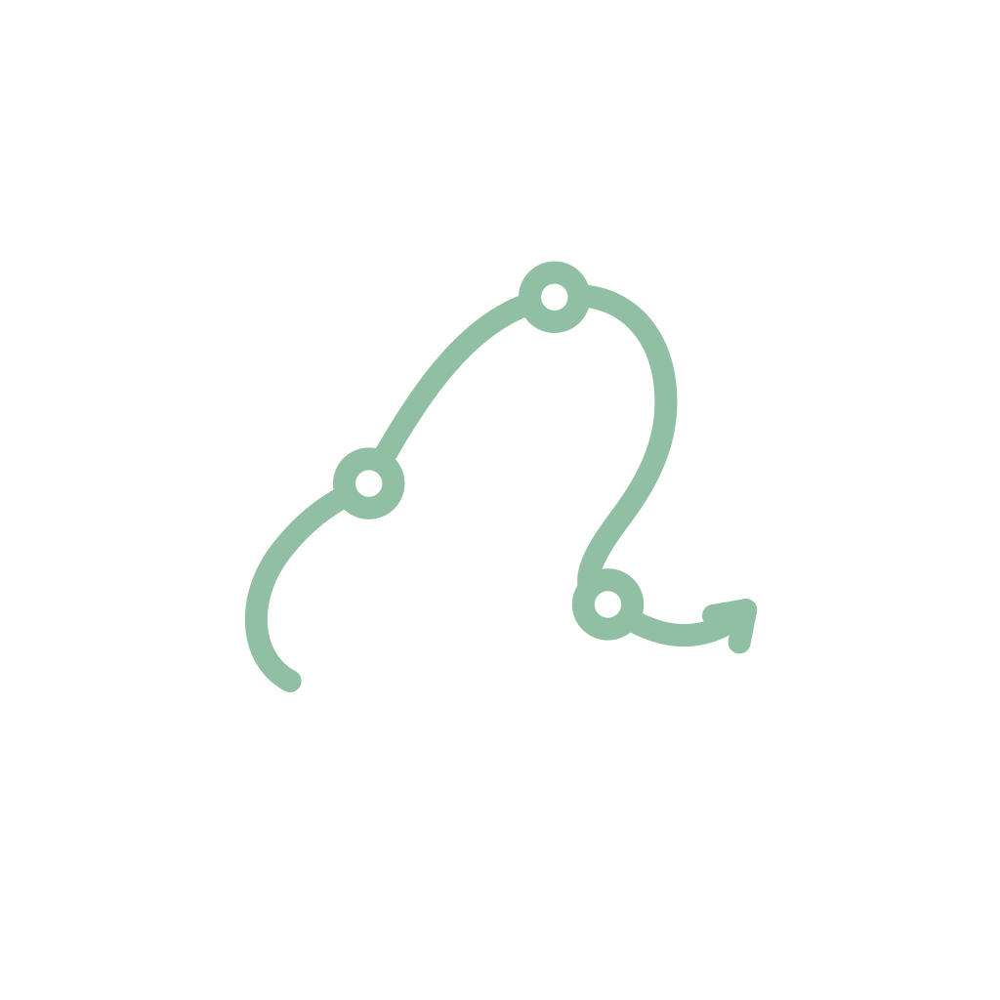

<h1 align="center">Life Events Log</h1>

Life Events Log helps you record, revisit, and make sense of the events in your life.

  
    
  
  

<strong>Free forever · No ads · Stored on your device</strong>

Capture events with photos and notes, add details such as categories, tags, people, and locations, and indicate how significant they are to you. Filter your events to find the moments you want to revisit, remember their context, and reflect on what happened.

  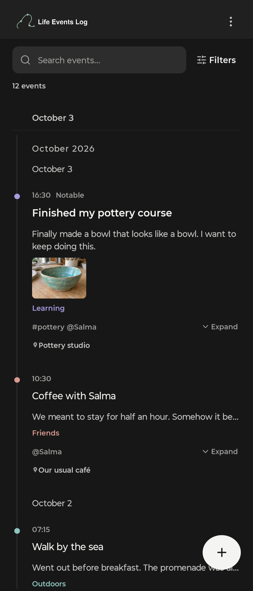
  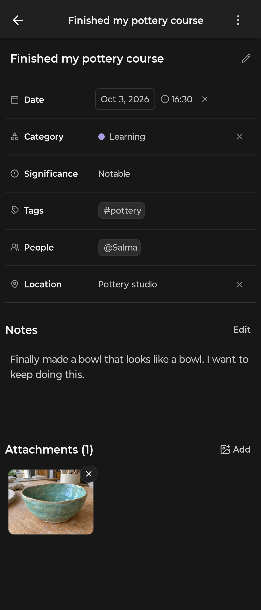
  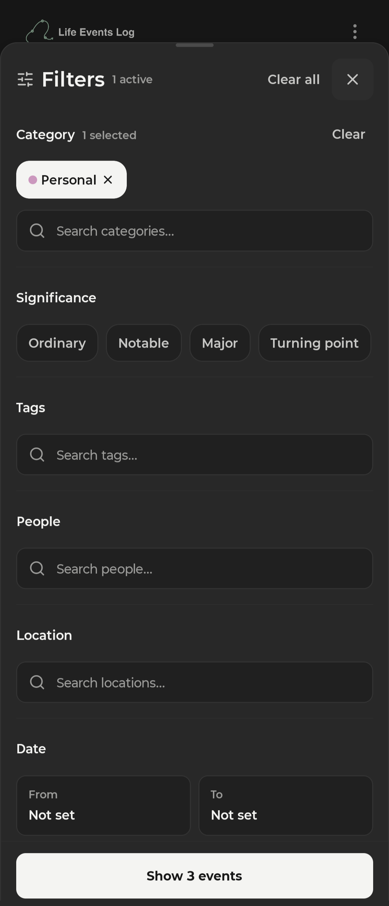

More screenshots

  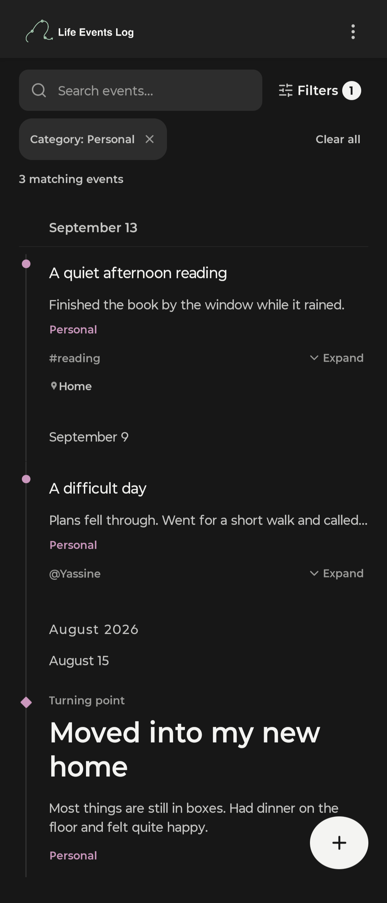
  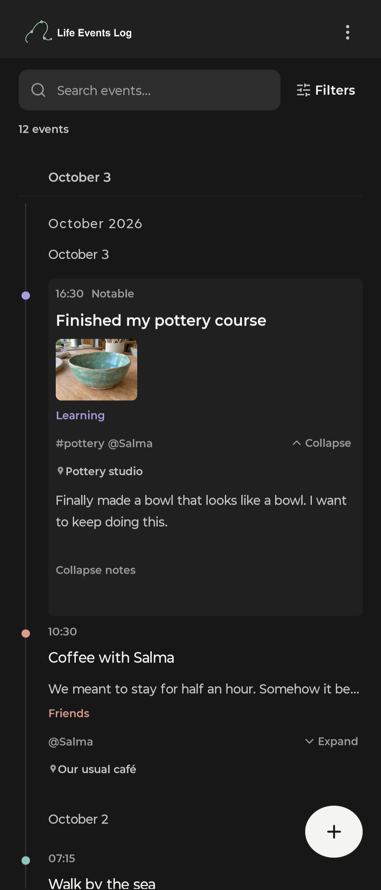
  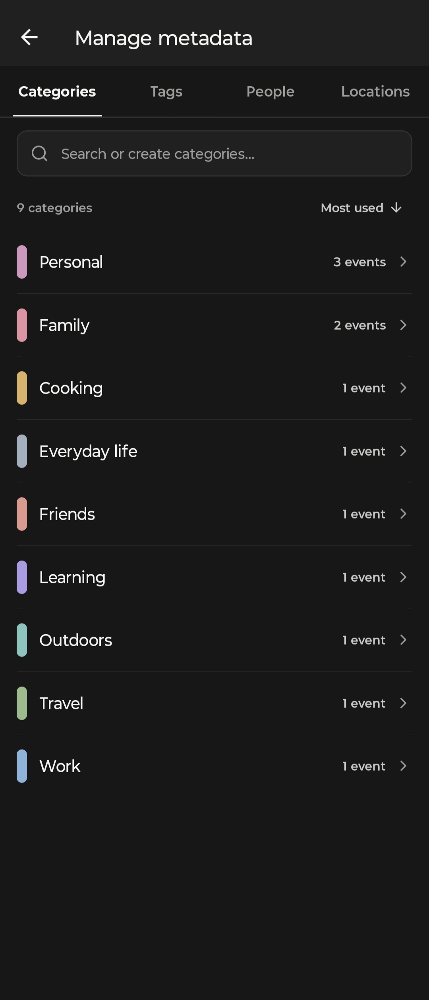

Light theme

  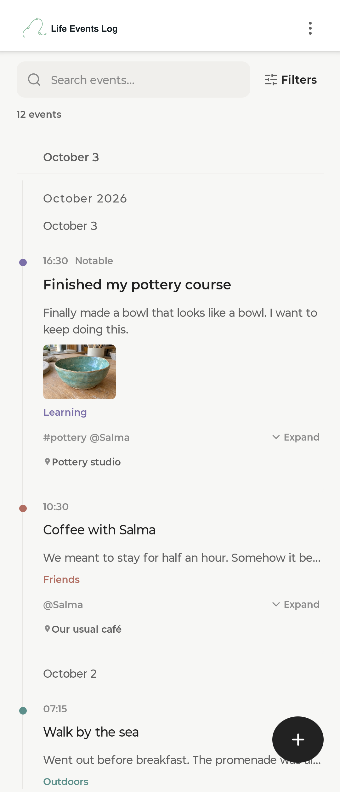
  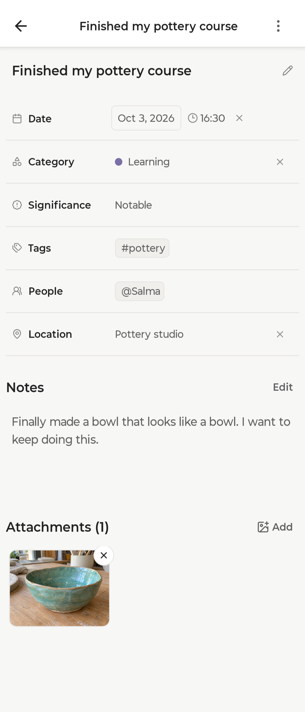
  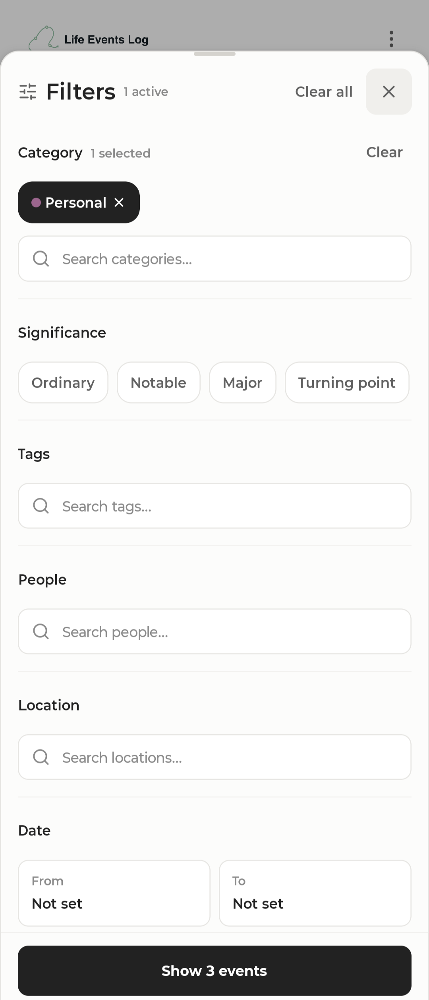
  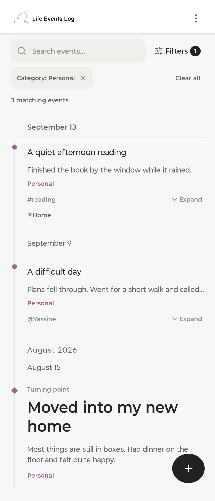
  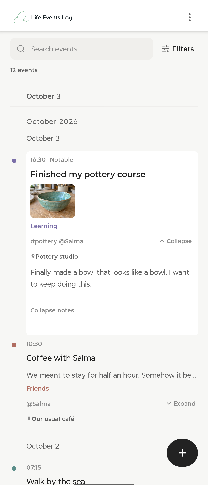
  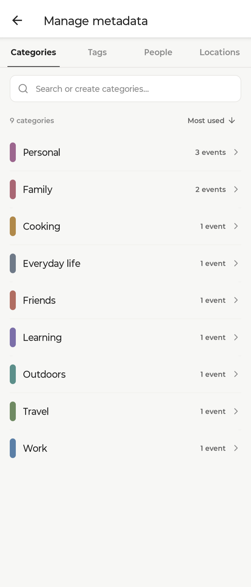

## Who is it for?

I started building this app because I sometimes have trouble remembering events in my own life. If that feels familiar, you might find it useful too.

There’s no prescribed way to use it. You can log everyday routines, major milestones, or anything in between; from brushing your teeth to welcoming your first baby. Record as much or as little as you want, and use it to organize, revisit, and make sense of your life events.

## Your life events, your data

Your life events belong to you. The app is free and will remain free, with no ads.

Your data is stored locally on your device. The app has no cloud backend or central server.

Syncing between devices currently works by creating and exchanging sync packages. You choose how to transfer those packages. See the [syncing process](#syncing) for details.

## Getting the app

- **Android APK:** [Download the latest release](https://github.com/benali-chadi/Life-Events-Log/releases/latest).
- **F-Droid:** Coming soon. The listing link will be added when available.
- **Obtainium**: Add https://github.com/benali-chadi/Life-Events-Log to Obtainium to install LEL and receive updates directly from GitHub.

## Syncing

Syncing currently works by exchanging packages between devices:

1. **Create a sync package** from the overflow menu (⋮).
2. **Transfer the package** however you prefer—for example, using Quick Share, a messaging app, or saving the file and sending it yourself.
3. **Import the package** on the receiving device.

During import, the app validates the package, merges its contents with your existing data, and runs an attachment repair step.

What is attachment repair?

After merging, the app checks for missing attachment files and restores any available in the sync package (including files that were missing before the import). Deleted attachments and attachments belonging to deleted events are skipped.

You can cancel this step without undoing the merge. Files that haven’t been restored will remain missing.

### Temporary files

Created sync packages stay in the app’s cache. Opening the system share menu doesn’t reliably tell the app when a transfer has finished, so it keeps the package available instead of deleting it immediately.

Once your transfers are complete, you can periodically clear the app’s **cache** in Android’s settings to reclaim space. Choose **Clear cache**, not **Clear storage/data**, which removes the app’s stored data.

## Calendar files (.ics)

You can import events from calendar files (`.ics`) and export all your events or just a selection in the same format.

**Calendar imports create new events every time.** Importing the same file twice will create duplicate events; it won’t update or merge previously imported ones. To sync between devices, use [sync packages](#syncing).

## AI use in this project

This project was built with AI assistance. AI helped write code, explore design choices, and draft documentation.

I initiated and made the final decisions about the app’s architecture, code organization, and user interface. I reviewed every line of code and worked to keep the implementation simple, adding design notes where larger modules or more complex implementations needed explanation.

AI assistance does not replace my responsibility for the project.

AI was used to help develop LEL. The app itself has no AI features and does not send your life events to AI services.

## Contributing and support

To report a bug, suggest an improvement, or ask for help, [open an issue](https://github.com/benali-chadi/Life-Events-Log/issues). For bugs, include what happened, what you expected, and steps to reproduce the issue. Use fictional examples rather than sharing private life events.

AI-assisted contributions are welcome, but you are responsible for what you submit. Review and understand your changes, verify that they work, and explain their purpose.

Unreviewed AI output and other low-effort pull requests will be rejected.

## Donations

LEL is free and will remain free. If you enjoy the app and find it useful, you can support its development with a donation.

## License

Life Events Log is licensed under the [GNU General Public License v3.0](LICENSE).
